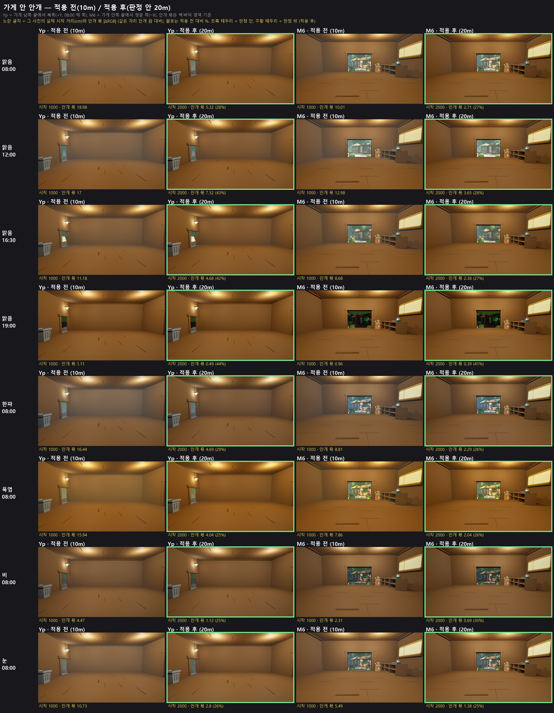
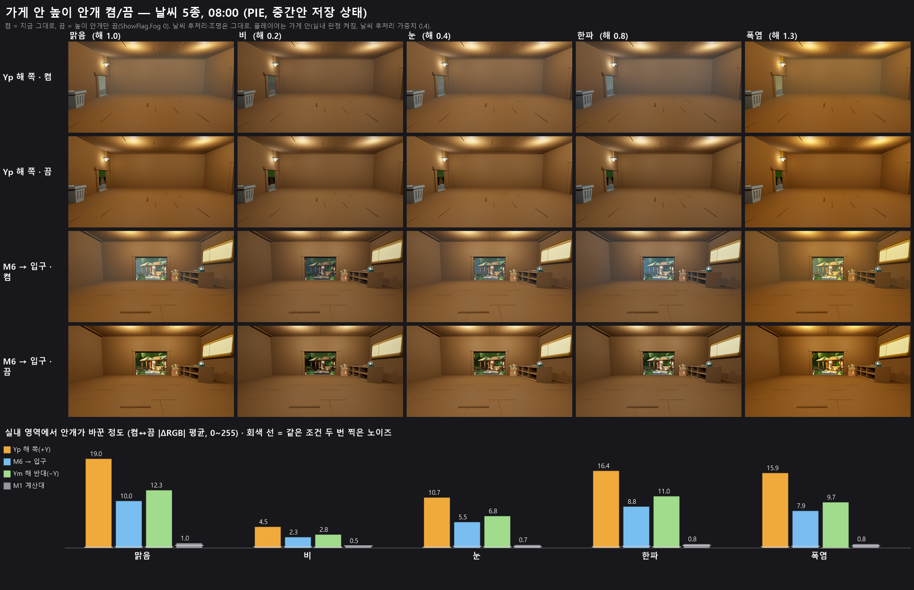
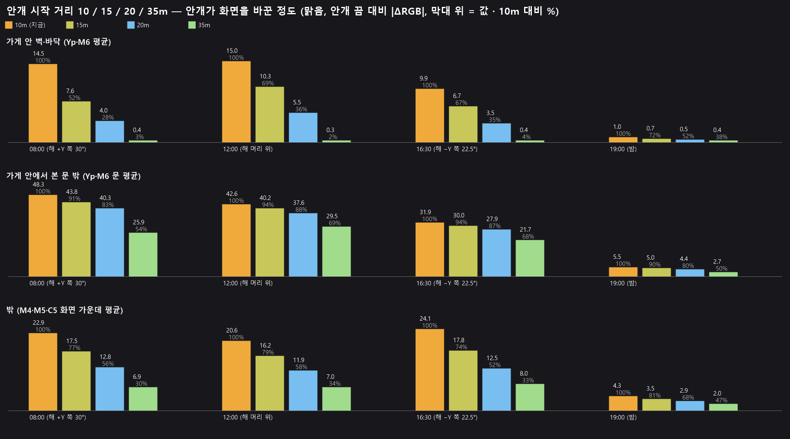
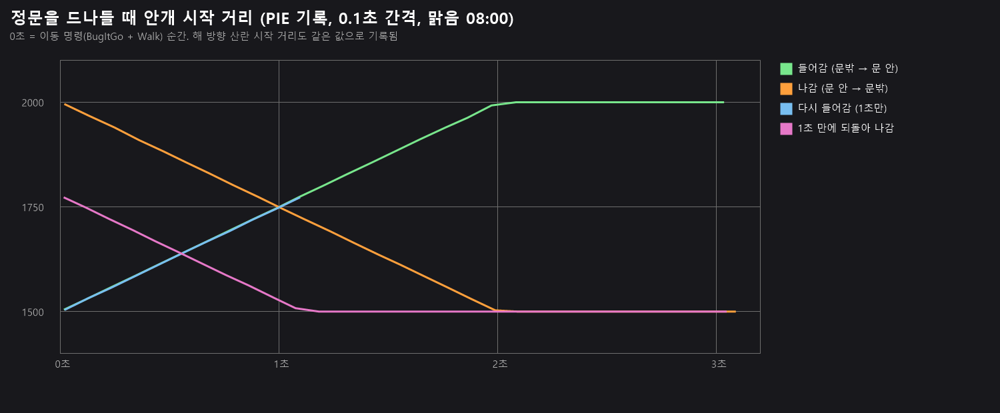
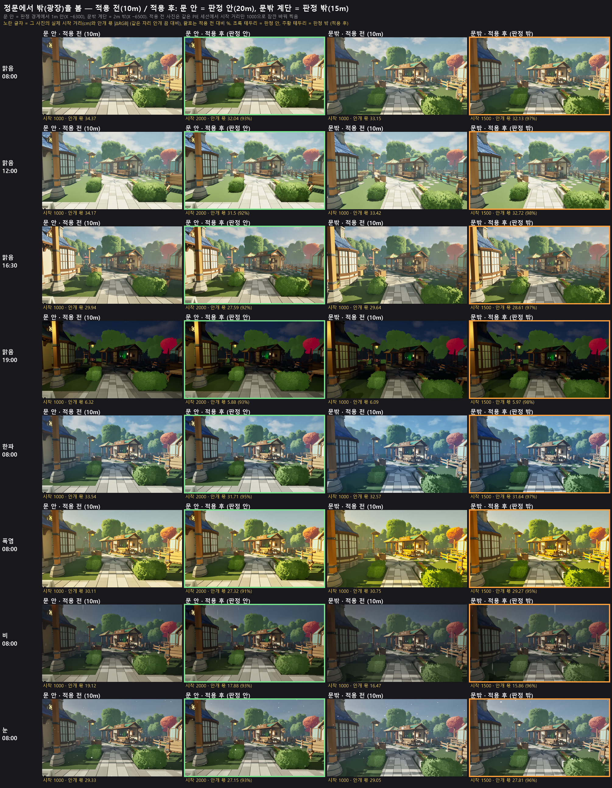

# **[UE5] 가게 안 안개를 줄이면서 문밖 풍경을 유지하기**

오늘은 맵 분위기 중간안을 적용한 뒤 발견한 **실내 안개 문제**를 조사하고 수정했습니다. 비나 눈이 올 때는 가게 안이 비교적 또렷한데, 맑음·한파·폭염에서는 실내에 밝은 막이 낀 것처럼 보였습니다.

10월 30일에 다뤘던 색보정과 분위기 설정에서 더 나아가, 이번에는 **원인 분리 → 시작 거리 비교 → 기존 실내 판정 연결 → 전환 검증**에 집중했습니다.

최종적으로 일반 안개와 해 방향 산란의 시작 거리를 **실외 15m / 실내 20m**로 나누고, 두 상태 사이를 속도 기반 선형 보간으로 전환했습니다.

> **이미지 1 — 최종 실내 결과**
> 
> 캡션: **“실내 시작 거리 10m → 20m. 날씨별로 가게 안에 생기던 밝은 안개 막을 줄인 결과.”**

<br>

## **1. 비 오는 날이 더 또렷한 이유부터 확인하기**

처음에는 비·눈 파티클을 지우는 WeatherBlocker나 실내 판정이 잘못됐을 가능성을 확인했습니다. 하지만 WeatherBlocker는 파티클에만 관여했고, 기존 실내 판정도 정상 작동하고 있었습니다. 실내에서는 날씨 후처리 가중치가 이미 0.4로 바뀌고 있었습니다.

문제는 **실내 판정이 안개 시작 거리에는 연결되지 않았다는 점**이었습니다.

현재 프로젝트에서 사용하는 높이 안개는 벽과 지붕을 실내 경계로 인식해 자동으로 제외하지 않습니다. 가게 크기는 약 28×27m인데 시작 거리가 10m여서, 가게 안에서도 먼 벽과 바닥에 안개가 보였습니다.

그런데 같은 실내라도 날씨마다 안개가 다르게 느껴졌습니다. 원인 측정에서는 가게 조명이 아니라 **안개를 밝히는 하늘빛과 햇빛의 차이**가 드러났습니다.

| 날씨 | 해 세기 | 긴 실내 장면 3곳의 평균 안개 영향 | 채도: 안개 끔 → 켬 |
| :--- | :--- | :--- | :--- |
| 맑음 | 10 | 13.8 | 0.73 → 0.52 |
| 한파 | 8 | 12.1 | 0.63 → 0.41 |
| 폭염 | 13 | 11.2 | 0.81 → 0.68 |
| 눈 | 4 | 7.7 | 0.65 → 0.53 |
| 비 | 2 | 3.2 | 0.63 → 0.57 |

여기서 안개 영향은 **안개를 켠 사진과 끈 사진의 측정 영역 평균 절대 RGB 차이**입니다. 안개 밀도나 불투명도 수치는 아닙니다.

맑음·한파·폭염에서는 밝은 안개가 실내 위에 크림색 막처럼 겹치며 채도를 낮췄습니다. 반면 비는 안개가 어두워 실내 조명에 상대적으로 묻혔습니다. **안개가 더 짙은 날씨가 화면에서도 반드시 더 뿌옇게 보이는 것은 아니었습니다.**

> **이미지 2 — 원인 비교**
> 
> 캡션: **“날씨별 실내 안개 켬/끔 비교. 밝은 날씨에서 실내 채도가 더 크게 낮아졌다.”**

<br>

## **2. 실내에서 안개를 끄면 창밖도 달라진다**

가장 간단한 해결처럼 보였던 방법은 실내에서 안개를 끄는 것이었습니다. 하지만 카메라가 실내에 있어도 문밖 풍경에는 안개가 필요했습니다. 안개를 끄면 문밖까지 갑자기 또렷해졌습니다.

| 검토한 방법 | 확인한 한계 |
| :--- | :--- |
| 실내에서 안개 끄기 | 문밖 안개도 함께 사라짐 |
| 실내에서 안개 색 어둡게 하기 | 맑은 날 문밖에 어두운 막이 생김 |
| 실내 채도·대비 보정 | 안개 막은 남고 문밖 색감도 바뀜 |
| 해 방향 산란 시작 거리만 늘리기 | 해 쪽 성분만 줄어 효과가 부족함 |
| 실내 판정에 따라 두 시작 거리 늘리기 | 가까운 실내 안개를 줄이면서 먼 문밖 안개를 상당 부분 유지 |

채택한 방법도 실내 영역만 정확히 안개에서 제외하는 방식은 아닙니다. **카메라에서 가까운 구간의 안개를 줄이는 타협안**입니다. 그래서 실내만 보지 않고 문밖과 출입 경계를 함께 비교해야 했습니다.

<br>

## **3. 가장 깨끗한 값보다 장면 전체에 맞는 값을 고르기**

시작 거리 10·15·20·35m를 시간대와 구도를 바꿔 비교했습니다. 아래는 일반 안개와 해 방향 산란 시작 거리를 함께 변경한 비교이며, 각 장면의 기존 10m 결과를 100%로 잡았습니다.

| 시작 거리 | 실내 벽·바닥에 남는 안개 영향 | 실내에서 본 문밖 | 실외 비교 장면 |
| :--- | :--- | :--- | :--- |
| 10m | 100% | 100% | 100% |
| 15m | 52~69% | 91~94% | 74~79% |
| 20m | 28~36% | 83~88% | 52~58% |
| 35m | 2~4% | 54~69% | 30~34% |

35m는 실내가 가장 깨끗했지만 문밖 안개까지 많이 줄었습니다. 맵 전체를 20m로 바꾸는 방법도 실외 안개를 절반 가까이 줄였고, 약 20m 앞 가게 정면에서는 21~26%만 남았습니다.

처음 계산에서는 실외 20m 설정에서도 안개가 77~91% 남을 것으로 예상했습니다. 실제 비교 장면에는 10~35m 거리의 건물이 많아 측정값이 더 낮았습니다. **먼 배경만 생각한 계산과 실제 화면 구성이 달랐던 것**입니다.

최종적으로 실외는 15m, 실내는 20m를 선택했습니다. 실내의 밝은 막은 충분히 줄이되 실외 분위기 손실과 문턱에서의 변화를 작게 만드는 조합이었습니다.

> **이미지 3 — 값 선택 근거**
> 
> 캡션: **“시작 거리 10·15·20·35m 비교. 실내가 깨끗해질수록 문밖과 실외 안개도 줄어드는 관계를 확인했다.”**

<br>

## **4. 기존 실내 판정을 환경 컨트롤러에 연결하기**

실내 판정 영역을 새로 만들지 않고, 날씨 서브시스템의 판정 결과를 환경 컨트롤러가 받도록 연결했습니다.

| 역할 | 구현 내용 |
| :--- | :--- |
| 날씨 서브시스템 | `OnShelterChanged(bool bIsSheltered)` 알림 제공 |
| 환경 컨트롤러 | 맵의 실외 시작 거리 저장, 판정 알림 구독, 목표와 보간 관리 |
| 맵 | 두 실외 시작 거리를 1500cm로 저장 |
| 실내 설정 | 두 시작 거리 기본값 2000cm, `ShelterBlendSeconds` 2초 |

레벨 시작 시 현재 실내 여부는 즉시 적용하고, 이후 판정이 바뀔 때 목표를 변경합니다. 날씨를 바꾸면서 같은 실내 판정이 다시 전달돼도 전환을 다시 시작하지 않습니다.

시작 거리는 다음 관계로 적용했습니다.

```text
실내 목표 거리 = max(맵에서 읽은 실외 거리, 실내 설정 거리)
현재 시작 거리 = Lerp(실외 거리, 실내 목표 거리, 실내 비율)
```

따라서 다른 맵의 실외 시작 거리가 이미 더 길더라도, 실내 진입 때문에 거리가 짧아지지는 않습니다. 일반 안개와 해 방향 산란은 각각의 거리 설정을 사용합니다.

날씨는 기존처럼 밀도와 색을 3초 동안 보간하고, 실내외 전환은 시작 거리를 별도로 보간합니다. **서로 다른 전환이 같은 Tick을 사용하므로 두 작업이 모두 끝난 뒤에만 Tick을 끄도록 처리**했습니다. 레벨 종료 시 시작 거리는 실외 값으로 복구합니다.

<br>

## **5. 문턱에서 돌아서도 이어지는 보간**

밖에서 안으로 완전히 전환하는 시간은 2초입니다. 실내 비율을 매초 0.5씩 목표 쪽으로 이동시켰습니다.

```text
비율 이동량 = DeltaSeconds / ShelterBlendSeconds
실외 목표 비율 = 0, 실내 목표 비율 = 1
```

핵심은 **방향이 바뀌면 현재 비율에서 그대로 되돌아가는 것**입니다. 절반 들어온 상태에서 나가면 2초를 새로 시작하는 대신 남은 절반만 이동합니다.

| 검증 동작 | 시작 거리 기록 |
| :--- | :--- |
| 실내 진입 | 1505 → 1748(1초) → 2000(2.05초) |
| 실외 이동 | 1996 → 1747(1초) → 1500(2.05초) |
| 진입 약 1초 뒤 되돌아감 | 1773에서 연속적으로 감소해 약 1.1초 뒤 1500 도달 |

전체 구간의 전환 시간을 2초로 정한 것이지, 방향을 바꿀 때마다 무조건 2초가 걸리도록 한 것은 아닙니다. 기존 날씨 후처리 페이드와 같은 시간·규칙을 사용해 색감과 안개 전환을 맞췄습니다.

> **이미지 4 — 전환 검증**
> 
> 캡션: **“실외 15m ↔ 실내 20m 전환. 도중에 방향을 바꿔도 현재 값에서 이어진다.”**

<br>

## **6. 반영 후 결과와 확인 범위**

코드 빌드 후 PIE에서 96장과 전환 기록으로 확인했습니다. 맑음 08:00의 대표 실내 두 장면은 안개 영향이 각각 **19.0 → 5.3**, **10.0 → 2.7**로 줄었습니다. 전자의 채도도 **0.48 → 0.63**으로 회복됐습니다. 안개를 완전히 끈 상태의 채도 0.73보다는 낮아 일부 영향은 남아 있습니다.

문 안에서 본 바깥 안개는 반영 전의 **91~95%**가 유지됐고, 같은 날씨에서 문 안·밖의 안개 영향 차이는 측정 지표 기준 **2 이하**였습니다. 문턱의 색감 차이 전체가 사라졌다는 뜻은 아닙니다. 날씨 후처리 가중치 0.4 ↔ 1.0 전환은 기존대로 남습니다.

판정 확인에서는 문 안·가게 안 32장 모두 2000/2000, 문밖 8장 모두 1500/1500이 적용됐습니다. 날씨를 네 번 바꿔도 시작 거리를 유지했고, PIE 종료 후 에디터 값도 1500/1500으로 돌아왔습니다.

> **이미지 5 — 문밖 풍경 유지 확인**
> 
> 캡션: **“실내 안개를 줄인 뒤에도 문밖 풍경의 안개를 유지하고, 출입 경계에서 차이를 비교했다.”**

자동 촬영은 순간 이동으로 진행했으므로 **직접 걸어서 드나드는 체감은 추가 확인이 필요**합니다. 창고·알바 사무소·집·연금술사 집의 실내 동작, UI·아웃라인도 아직 확인하지 않았습니다. 성능 개선 수치는 이번 기록에 없습니다.

또한 공통 코드는 다른 테스트 맵에도 적용되지만 실외 15m는 MiddleTestMap에만 저장했습니다. `BMStestMap2`·`BRDF`·`BRD_`는 실외 10m를 유지하므로 각 맵에서 출입 경계를 따로 확인해야 합니다.
